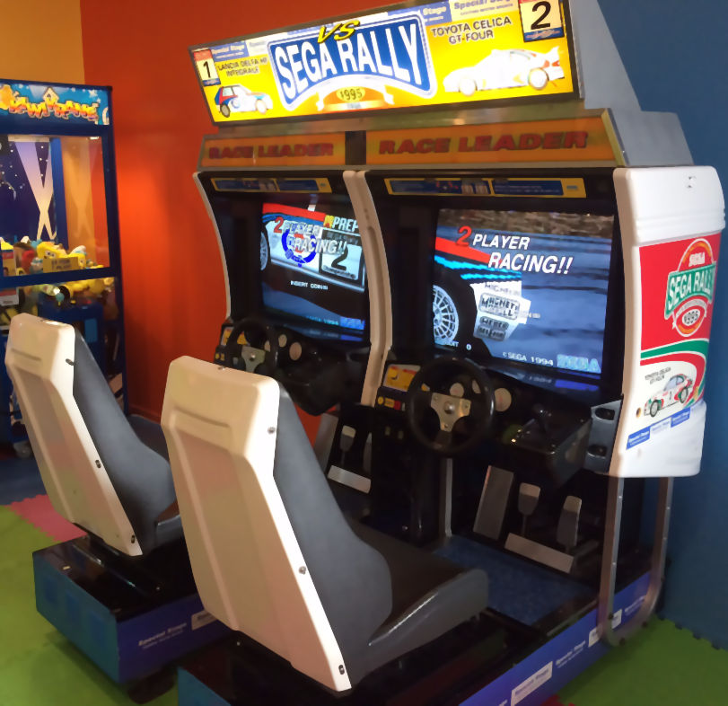
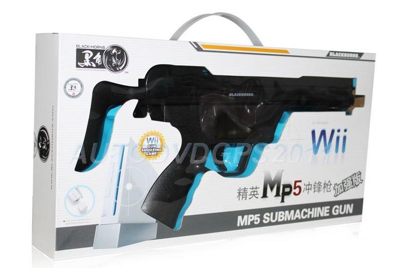
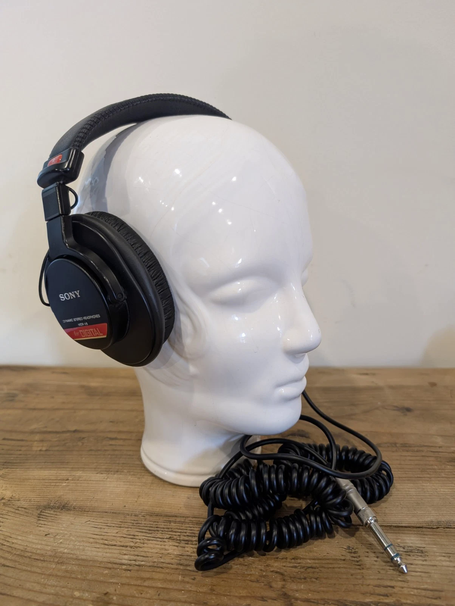
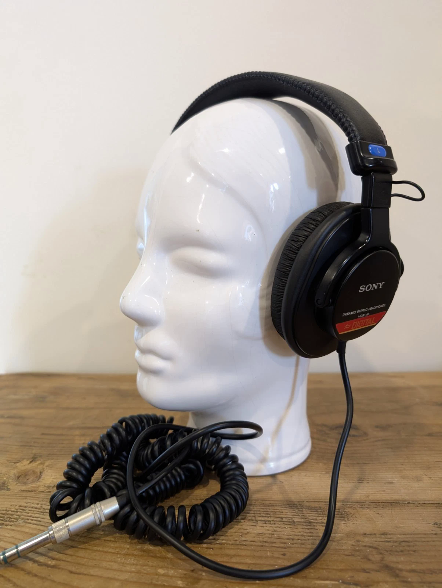
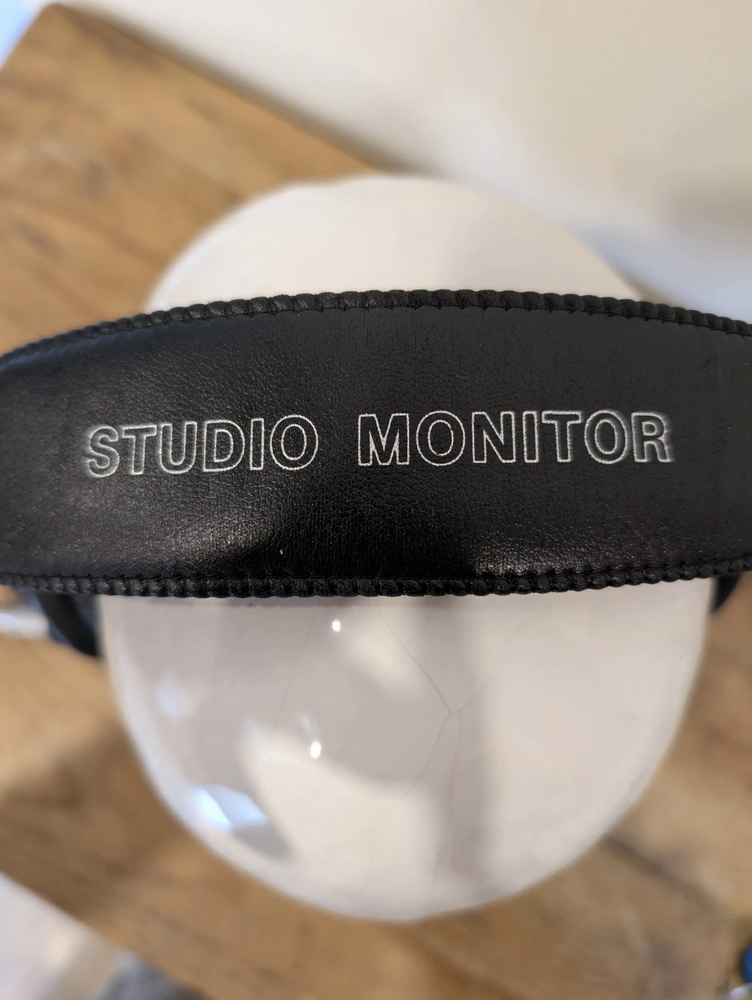
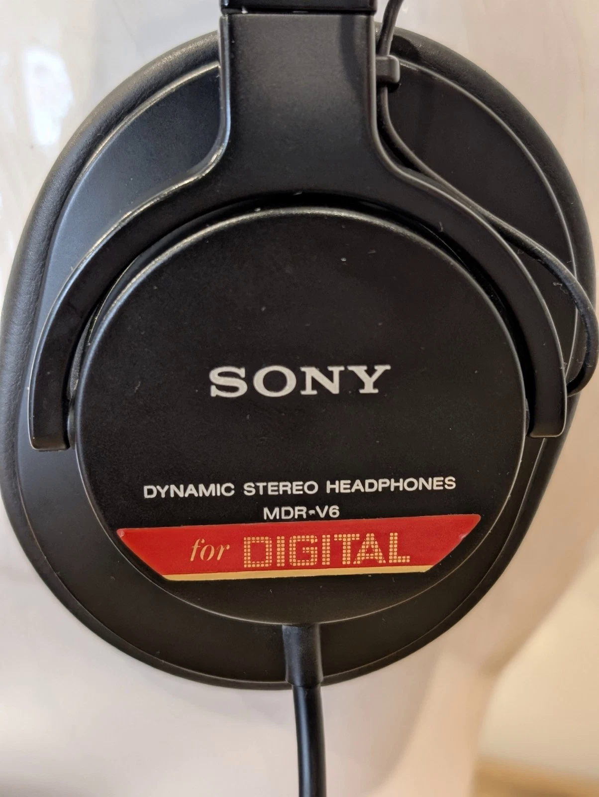
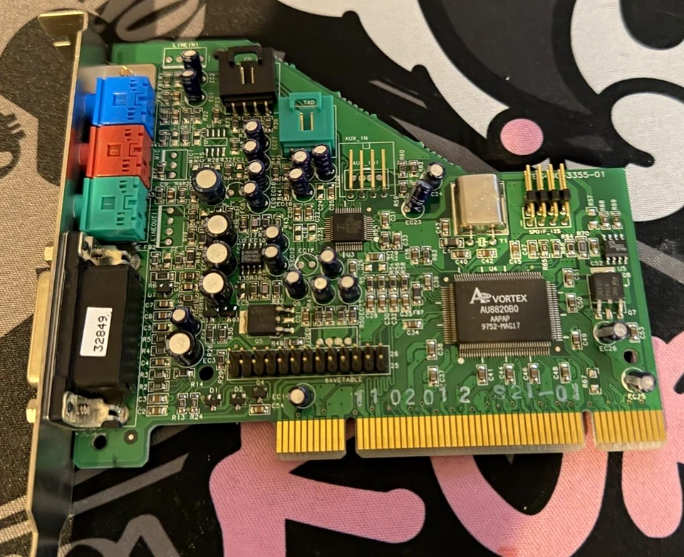

# marines-modern-urban-combat-wii-swat3
## Marines Modern Urban Combat Wii - SWAT3 Remake
A remake of *SWAT3* rebuilt in the **Marines Modern Urban Combat Wii** engine/project.

## Github Treeview
[https://treegit.macosxjs.com/?url=igiteam/marines-modern-urban-combat-wii](https://treegit.macosxjs.com/?url=igiteam/marines-modern-urban-combat-wii)

## Github Tree Api Direct JSON
[https://api.github.com/repos/igiteam/marines-modern-urban-combat-wii/git/trees/main?recursive=1](https://api.github.com/repos/igiteam/marines-modern-urban-combat-wii/git/trees/main?recursive=1)

## Base Gameplay 

## WS11WineCX20.0.4 (macOS Big Sur 32-bit)

[WS11WineCX20.0.4.tar.7z](https://github.com/vitor251093/porting-kit-engines/releases/download/wineskin/WS11WineCX20.0.4.tar.7z)

## Reference Links

[https://vimm.net/vault/64388](https://vimm.net/vault/64388)

[https://github.com/dolphin-emu/dolphin](https://github.com/dolphin-emu/dolphin)

[https://dolphin-emu.org/](https://dolphin-emu.org/)

## SWAT3 Twin Arcade mode
[https://readme.macosxjs.com/?url=https%3A%2F%2Fgithub.com%2Figiteam%2Fmarines-modern-urban-combat-wii-swat3%2Fblob%2Fmain%2FMACOSX_THUNDERBOLT.md](https://readme.macosxjs.com/?url=https%3A%2F%2Fgithub.com%2Figiteam%2Fmarines-modern-urban-combat-wii-swat3%2Fblob%2Fmain%2FMACOSX_THUNDERBOLT.md)

[https://readme.macosxjs.com/?url=https%3A%2F%2Fgithub.com%2Figiteam%2Fmarines-modern-urban-combat-wii-swat3%2Fblob%2Fmain%2FMACOSX_TWIN_HEADLESS_ARCADE.md](https://readme.macosxjs.com/?url=https%3A%2F%2Fgithub.com%2Figiteam%2Fmarines-modern-urban-combat-wii-swat3%2Fblob%2Fmain%2FMACOSX_TWIN_HEADLESS_ARCADE.md)

[https://adb.arcadeitalia.net/dettaglio_mame.php?game_name=srallyc&lang=en](https://adb.arcadeitalia.net/dettaglio_mame.php?game_name=srallyc&lang=en)

[https://github.com/xandoxan65/segarally95-recomp](https://github.com/xandoxan65/segarally95-recomp)

### Reference Images: Sony MDR-V6

These are period-correct studio monitors, highly recommended for testing the "analytical" side of Aureal Vortex A3D.

| Image 1 | Image 2 | Image 3 | Image 4 |
| :---: | :---: | :---: | :---: |
|  |  |  |  |

*(Note: These images are from an eBay listing, used here for product identification.)*

---

## Dev Environment

**Official White Wii Remote With Nunchuk — Tested And Working — £14.99**
[https://www.ebay.co.uk/itm/800847189353](https://www.ebay.co.uk/itm/800847189353)

**Infrared Sensor Bar USB for Wii Emulator Remote Motion Detection Setup — £6.69**
[https://www.ebay.co.uk/itm/227423830875](https://www.ebay.co.uk/itm/227423830875)

**Apple MacBook Pro Retina 15in (2014) i7 2.8GHz 16GB 1TB SSD GT 750M — £120.30**
[https://www.ebay.co.uk/itm/800844561513](https://www.ebay.co.uk/itm/800844561513)

**WS11WineCX20.0.4 (Wine engine)**
[https://igiteam.github.io/wine_engines/](https://igiteam.github.io/wine_engines/)

**Official Genuine Sony PS3 PlayStation 3 DualShock 3 Wireless Controller Black — £19.99**
[https://www.ebay.co.uk/itm/840031043465](https://www.ebay.co.uk/itm/840031043465)

**Amazon Basics 4K HDMI Cable 3m — 18Gbps High Speed with Ethernet, 4K@60Hz, 2160p — £8.44**
[https://www.ebay.co.uk/itm/327352257557](https://www.ebay.co.uk/itm/327352257557)

**wiimote_nunchuk_macosx**
[https://github.com/igiteam/wiimote-nunchuk](https://github.com/igiteam/wiimote-nunchuk)

**xbox360_input_gui_py**
[https://github.com/igiteam/xbox360_input_gui_py](https://github.com/igiteam/xbox360_input_gui_py)

**logitec_mx_mouse_3_macos**
[https://github.com/igiteam/logitec_mx_mouse_3_macos](https://github.com/igiteam/logitec_mx_mouse_3_macos)

**igi1-macbook-3d-workstation**
[https://github.com/igiteam/igi1-macbook-3d-workstation](https://github.com/igiteam/igi1-macbook-3d-workstation)

---
